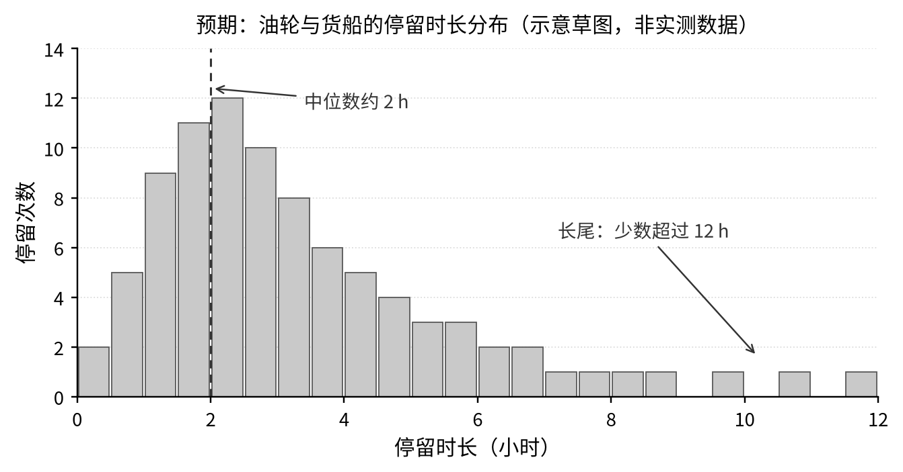

# 02 dream · B1 港口停留与拥堵：选题书

**小组与轨道**

| 项目 | 内容 |
|---|---|
| 组号 / 组名 | 02 / dream（文件夹 `02_dream`） |
| 轨道 | B 轨，任务包 B1「港口停留与拥堵」 |
| 组员与分工 | 王国梁（组长，搜集资料、制作内容、汇报展示）、景亚宁（图表、数据与清洗） |
| 复现包 | <https://github.com/jyn0219/02-dream>（Public，未登录可打开） |

## 一、问题

2017 年 7 月 5 日，哥德堡港区内油轮与货船的停留时长呈什么分布？以「商船在港船时」
（船·小时/天）作为港口拥堵的代理指标时，它在哪些参数范围内稳定、在什么条件下失效？

- 分析层次：描述 + 方法评估。只描述该日、该港区两类商船的停留分布，并用九组参数检验
  口径是否稳健；不做因果推断，也不外推为哥德堡港的常态。
- 答案会改变谁的决定：港口调度和码头计划员可用「商船在港船时」估计港区同时压着多少商船
  （默认参数下平均在停 8.2 艘、合计 197 船·小时/天；九组参数下 185–203 船·小时/天）；
  货主和货代不能把它当作「等泊时间」，
  因为数据分不清靠泊作业与锚地排队，拿它谈滞期费或考核船期会误算；对外发布或横向比较时，
  须固定航速门槛、最短时长与缺口，并注明「仅港区、仅单日」。

## 二、数据

| 项目 | 内容 |
|---|---|
| 文件 | `ais_gothenburg_20170705.csv`（6.5 MB） |
| 内容 | 瑞典哥德堡港水域 2017-07-05 全天 AIS 船位 |
| 来源 | 丹麦海事局（DMA）AIS 开放数据，经 movingpandas-examples 整理为课程样本包 |
| 性质 | 官 |
| 许可 | 免费使用，须署名 |
| 获取方式 | 课程网站「数据实验室」直接下载，已存入 `data/raw/` |
| 规模 | 84,702 行 × 8 列；100 艘船；记录间隔中位数 10 秒 |
| 字段 | timestamp、mmsi、lat、lon、sog、cog、name、shiptype |

**来源五问**：谁发布的：丹麦海事局；为什么发布：海事安全与航行信息；怎样得到：官网开放下载，
经课程裁剪；有什么局限：只覆盖港区、只有一天、关闭 AIS 的船不在内；许可与引用：免费使用，
须署名。

**已经下载了什么**：原始 CSV 与压缩包各一份；已用 `analysis/01_clean.py` 完成清洗与停留识别，
默认参数下得到 215 次停留、56 艘船、512.5 小时，与教材一致。

## 三、预期的图

| 项目 | 内容 |
|---|---|
| 横轴 | 停留时长（小时），0–12 |
| 纵轴 | 停留次数 |
| 分组 | 油轮、货船（先各画一张，再合并） |
| 期望看到 | 右偏长尾：大量 1–3 小时的停留，少数超过 12 小时；中位数约 2 小时 |
| 备选主图 | 全天在停船数曲线（存量），横轴时刻、纵轴艘数 |

图 1　预期：油轮与货船的停留时长分布（横轴停留时长 0–12 小时，纵轴停留次数；示意草图，非实测数据）

## 四、最不确定的地方

下表汇总开题质询与选题集市上收到的意见，以及逐条的处理办法。

| # | 收到的意见 / 自己的担心 | 处理办法 |
|---|---|---|
| 1 | AIS 数据没有码头与锚地的地理边界，识别出的“在港时长”无法区分靠泊作业与排队等泊，容易被直接当作真实待泊时间使用。 | 把“商船在港船时”明确定义为拥堵的代理指标，而非等待时间；在报告的“不能回答什么”中写明该口径缺陷，全文不作因果推断，并用参数敏感性检验说明读数的适用边界。 |
| 2 | tau=30 分钟的最短停留门槛会滤掉短时间靠泊的船舶（如渡轮），门槛一改，停留事件的数量和时长统计就跟着变，参数选择直接决定结果。 | 做 tau=10/30/60 分钟的多组敏感性对比，检验结论是否稳健；分析主体只保留油轮与货船，并在报告中说清参数取舍带来的偏差。 |
| 3 | 只有单日 AIS 样本，2017-07-05 的运行状态未必代表常态，结论向其他日期推广的可靠性有限。 | 明确所有结论只适用于该日、该水域、该船型；在局限部分强调单日样本的约束，不向哥德堡港的长期运行状况泛化。 |
