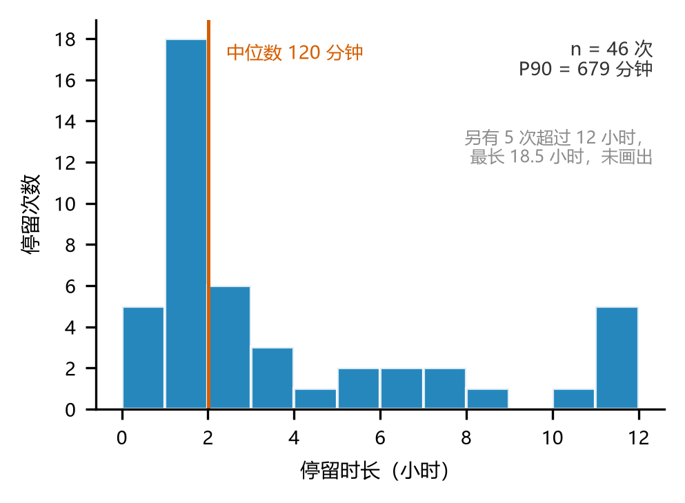
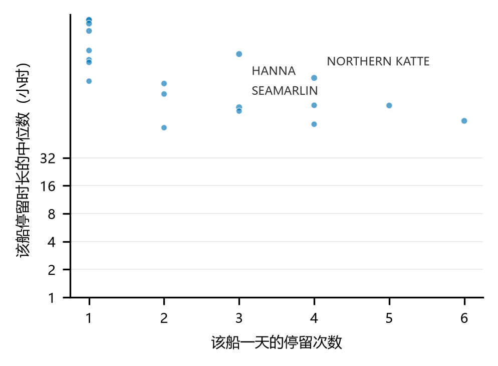
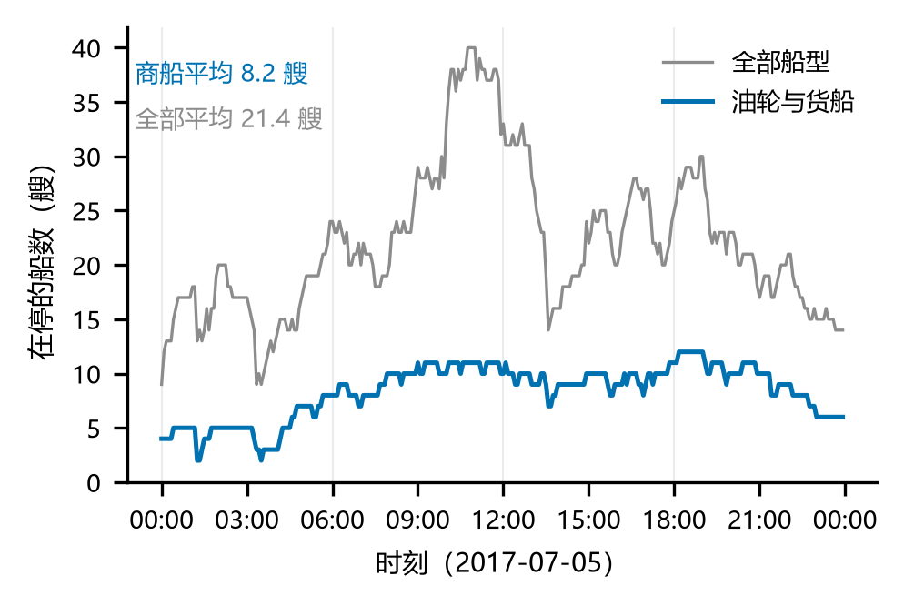

# 哥德堡港的船舶停留与港口拥堵（2017-07-05）

组员：王国梁、景亚宁

## 摘要

据2017-07-05哥德堡港区84,702条AIS记录，用0.5节、30分钟、10分钟缺口识别商船停留，按存量、流量与时长比较，以3×3网格检验敏感性。商船停留46次，当日中位时长120.3分钟，平均在停8.22艘；在港船时185–203船·小时/天。它仅描述受日界截断的港区停留，不等于等泊时间。

## 1 问题

### 1.1 研究问题

本文研究：2017年7月5日，哥德堡港区内油轮与货船的停留时长分布如何；以“商船在港船时（船·小时/天）”和“平均在停商船数”为拥堵代理指标时，结果在什么参数范围内稳定、在什么条件下失效？研究属于描述性分析，并包含对指标口径和参数稳健性的方法评估；由于没有靠离泊记录、锚地边界或外部拥堵对照，本文不作因果解释。

### 1.2 谁会因此改变什么决定

港口调度人员可以用停留时长分布和全天在停船数安排泊位、引航与装卸资源，并关注峰值时段是否持续。航运经营者可以用同一口径比较油轮和货船的停留特征，但不能据此认定船舶在等待泊位。货主真正关心的是“等了多久”，而本文只能观察到船舶在港区内低速停留了多久，两者不能画等号。若把港区停留直接当作等泊时间用于索赔或考核，指标换了口径却沿用原来的解释，就会产生误导。

## 2 数据

### 2.1 来源与许可

| 项目 | 内容 |
|---|---|
| 文件 | ais_gothenburg_20170705.csv |
| 内容 | 瑞典哥德堡港水域2017-07-05全天AIS船位 |
| 来源 | 丹麦海事局（DMA）AIS开放数据，经movingpandas-examples整理为课程样本包[1] |
| 性质 | 官方开放数据 |
| 许可 | 免费使用，须署名 |
| 下载日期 | 2026-10-29 |
| 原始文件SHA-256 | 01F7858A41F67135219821E9D2B7BD8F06E571CAECDA5B6B3C8797114F182EE8 |

**来源五问**：谁发布的：丹麦海事局；为什么发布：海事安全与航行信息；怎样得到：官网开放下载，
经课程裁剪；有什么局限：只覆盖港区、只有一天、关闭 AIS 的船不在内；许可与引用：免费使用，
须署名。

### 2.2 字段与规模

原始文件共84,702行、8列；有效记录为84,699行，涉及100艘船和去空值后的97个船名。主要字段如下。

| 字段 | 含义 | 备注 |
|---|---|---|
| timestamp | 记录时间 | 原始格式为日/月/年 时:分:秒 |
| mmsi | 船舶识别码 | 100艘 |
| lat / lon | 纬度 / 经度 | WGS-84 |
| sog | 对地航速（节） | 3行缺失 |
| cog | 对地航向（度） | 500行缺失，本文不使用 |
| name | 船名 | 97个，同船可能对应多个名称 |
| shiptype | 船型 | 1,280行为Undefined |

记录间隔中位数为10秒，超过10分钟的记录缺口有797处。

### 2.3 清洗日志

清洗与停留识别按以下六步执行。时间按dayfirst=True解析，以保留2017年7月5日的正确日期；只删除无法参与停留判断的关键字段缺失记录；记录缺口本身不删除，而是作为停留中止条件。船型按整艘船取众数，使同一艘船不因少量Undefined记录而被重复归类[2][4]。

| 步骤 | 操作 | 规则与理由 | 行数变化 |
|---|---|---|---|
| 1 | 读入并解析时间 | dayfirst=True；否则7月5日可能被读成5月7日 | 84,702行 |
| 2 | 删除关键字段缺失的记录 | 缺时间、船舶标识、位置或航速的记录无法参与停留识别 | 删除3行 → 84,699行 |
| 3 | 按船、按时间排序并计算相邻间隔 | 停留识别依赖同一艘船的记录顺序和时间间隔 | 84,699行 |
| 4 | 船型按船取众数 | 同船不同记录可能是Undefined，逐行归类会造成同船船型不一致 | 84,699行；1,280个Undefined值并入所属船 |
| 5 | 识别停留 | 航速门槛0.5节、最短时长30分钟、记录缺口10分钟 | 84,699条位置记录 → 215次停留 |
| 6 | 写出停留表 | 供探索分析和拥堵指标计算使用 | 215行；56艘船、512.5船·小时 |

对结论影响最大的取舍是记录缺口规则。若把长时间断联前后的低速记录直接相连，就会把未被观测到的时间误算为停留，尤其会拉长分布右尾。其次是30分钟最短时长，它会主动排除短靠港和渡轮式停留，因此主结果只能解释为油轮与货船的较长停留。

## 3 方法

### 3.1 停留的定义

一次停留由连续若干条航速低于v0的记录组成，持续不少于tau分钟；若相邻两条记录间隔超过gap分钟，则前一停留结束，缺口中的时间不计入停留。

| 参数 | 取值 | 理由 |
|---|---|---|
| v0 | 0.5节 | 港作船舶和商船靠泊时的AIS对地航速通常在零点几节内波动，0.5节可在保留低速靠泊的同时排除明显航行。把门槛降到0.2节后，0.2–0.5节之间的低速运动不再计为停留，商船在港船时变为194.3船·小时/天，比基准低1.5%。 |
| tau | 30分钟 | 油轮与货船的装卸、补给通常持续数小时，30分钟可过滤短暂减速和单点波动，又能保留短于1小时的作业。取10分钟和60分钟时，商船在港船时分别为201.7和193.1船·小时/天，相对基准变化+2.2%和−2.1%。该门槛会漏掉客船和渡轮的短停，所以主指标不覆盖快速客运。 |
| gap | 10分钟 | 原始记录间隔中位数为10秒，超过10分钟的中断有797处，明显不同于正常采样节奏。将其视为观测中断，可以避免把断联期间的未知运动状态算作停留。 |

### 3.2 拥堵的三种量法

表1给出存量、流量和时长三种量法。存量回答“此刻有多少船在停”，流量回答“单位时间开始多少次停留”，时长回答“每次停留持续多久”。

| 量法 | 定义 | 全部船型 | 仅油轮与货船 |
|---|---|---|---|
| 存量 | 某一时刻在停的船数 | 平均21.35艘，最多40艘 | 平均8.22艘，最多12艘 |
| 流量 | 单位时间开始停留的次数 | 8.96次/小时 | 1.92次/小时 |
| 时长 | 每次停留的持续时间 | 平均2.38小时，中位数1.26小时 | 平均4.29小时，中位数2.00小时 |

三者在观测窗口相对稳定时由利特尔法则联系[3]：L = λW，其中L为平均在停船数，λ为单位时间开始停留的次数，W为平均停留时长。全部船型数据满足21.35 ≈ 8.96 × 2.38。它用于检查三种指标是否来自同一口径，不能证明港口处于排队平衡状态。

### 3.3 为什么只保留油轮与货船

215次停留中包含帆船、游艇、引航船、搜救船等，这些活动与研究商船港口拥堵无关，且会抬高全部船型的在停数量。只保留Tanker与Cargo后得到46次停留、19艘船和197.2船·小时/天，使总量指标与研究对象一致。代价是样本显著缩小，单船差异更重要，因此结果主要报告分布、中位数和参数范围，而不把46次停留外推为全年常态。

## 4 结果

### 4.1 停留时长的分布（图1）

图1　哥德堡港油轮与货船的停留时长分布（2017-07-05）。数据来源：丹麦海事局AIS官方开放数据，课程样本包。关键参数：航速门槛0.5节、最短时长30分钟、缺口10分钟；只保留油轮与货船。口径说明：n = 46次停留，横轴截到12小时，竖线为中位数120分钟。

油轮与货船的46次停留呈明显右偏分布：中位数为120.3分钟，P90为679分钟，平均数被长尾拉高到257.3分钟；有5次超过12小时，最长约18.5小时。这说明典型停留约2小时，但少数长时间停留贡献了较多在港船时。需要注意，10次停留从00:05前开始或到23:55后仍未结束，涉及76.0船·小时，占观测船时的38.5%；这些时长只是日内观测下界，图1的分布应理解为“当日可见停留时长”，而不是完整事件时长。横轴截到12小时只是为了避免少数极端值压缩主体，超限次数已在图中注明；解释中心位置时应使用中位数，而不是平均数。

### 4.2 哪些船贡献了在港船时（图2）

图2　每艘商船的停留次数与停留时长中位数。数据来源：丹麦海事局AIS官方开放数据，2017-07-05。关键参数：0.5节 / 30分钟 / 10分钟缺口；只保留油轮与货船。口径说明：n = 19艘船，点的大小为该船当天的在港船时，纵轴为对数刻度。

19艘商船中，单船最多记录6次停留。停留次数多并不等于每次停留都长：点沿横轴右移时，纵轴上的中位时长仍有较大差异。在港船时最多的3艘船合计占商船总在港船时的29.4%，说明船时并非完全集中于单一船舶，但少数长停仍会明显影响均值。港口资源评估因此应同时看停留次数、中位时长和总船时，不能只按到港次数排序。

### 4.3 全天的在停船数（图3，主图）

图3　哥德堡港全天在停的船数（5分钟粒度）。数据来源：丹麦海事局AIS官方开放数据，课程样本包。关键参数：0.5节 / 30分钟 / 10分钟缺口；含全部船型与仅商船两种口径。口径说明：任一时刻处于停留中的船数，单位艘；按停留总时长计，商船平均8.2艘、全部船型平均21.4艘。

全部船型的在停船数在上午约10:49达到当天最高的40艘；只看油轮与货船时，最高为12艘，出现在约18:13。两条曲线的平均差为13.1艘，说明若把游艇、引航船和搜救船混入总量，曲线高峰会被大量非商船活动放大。商船曲线均值虽为8.22艘，但不同时刻的数量明显波动，因此不能用某一天的均值直接代表港口长期拥堵水平。

### 4.4 参数敏感性（表2）

| v0（节） | tau（分钟） | 全部停留次数 | 商船停留次数 | 商船在港船时 | 平均在停商船数 |
|---|---|---|---|---|---|
| 0.2 | 10 | 443 | 71 | 199.3 | 8.30 |
| 0.5 | 10 | 386 | 59 | 201.7 | 8.40 |
| 1.0 | 10 | 384 | 57 | 202.9 | 8.45 |
| 0.2 | 30 | 242 | 55 | 194.3 | 8.10 |
| 0.5 | 30 | 215 | 46 | 197.2 | 8.22 |
| 1.0 | 30 | 212 | 46 | 199.0 | 8.29 |
| 0.2 | 60 | 148 | 43 | 184.7 | 7.70 |
| 0.5 | 60 | 133 | 41 | 193.1 | 8.04 |
| 1.0 | 60 | 132 | 41 | 194.8 | 8.12 |

注：表2由analysis/03_congestion.py生成，表中“商船”指油轮与货船；在港船时单位为船·小时/天。

全部停留次数随tau从10分钟升到60分钟而由386降到133，这是门槛变严后主动删除短停留造成的机械变化，不能解释为港口实际到港量下降。相比之下，九组参数下商船在港船时只在184.7–202.9船·小时/天之间变化，最低值相对最高值约低9.0%，平均在停商船数约在7.7–8.45艘之间，结论对单个参数不敏感。一次只改一个参数时，tau取10或60分钟分别使基准船时变化+2.2%和−2.1%，v0取0.2或1.0节分别变化−1.5%和+0.9%。因此，“当天商船在港船时约为200船·小时”在测试范围内较稳定，而“停留次数”不是稳健指标。

## 5 局限：这份数据不能回答什么

| # | 因为 | 所以不能回答 |
|---|---|---|
| 1 | 课程样本只提供港区AIS位置，没有码头、泊位和锚地边界 | 不能把“在港停留”等同于“在锚地等泊”，也不能区分装卸、补给、避风与等待指令 |
| 2 | 数据只覆盖2017-07-05的00:00–24:00，跨日停留必然被日界截断 | 不能把图1的每次时长都作为完整停留事件；边界附近10次、76.0船·小时的时长仅为当日观测下界 |
| 3 | 只有2017年7月5日一天，不能建立工作日、季节和事件基线 | 不能判断当天是常态还是异常，也不能识别长期趋势或其他日期的拥堵差异 |
| 4 | 停留由0.5节、30分钟和10分钟缺口规则识别，关闭AIS或采样中断的船舶不在完整观测内 | 不能得到全港真实船舶总量，也不能证明未被记录的时间在做什么 |
| 5 | AIS中的船名、船型和轨迹字段可能缺失或由船端配置，不包含货量、合同和靠离泊事件 | 不能据此计算真实等泊时间、装卸效率、经济成本或责任归属 |

## 6 结论

在2017年7月5日、哥德堡港区AIS范围及0.5节 / 30分钟 / 10分钟缺口的口径下，油轮与货船共识别46次停留、19艘船，当日可见停留时长中位数为120.3分钟，平均为257.3分钟，分布呈明显右偏。商船平均在停8.22艘，全天观测在港船时为197.2船·小时；在3×3参数网格中，在港船时介于184.7–202.9船·小时，主体结论基本稳定，但停留次数和全部船型总量会随口径明显变化。故本文能够给出“当天商船在港停留的规模与长尾特征”，不能给出“哥德堡港长期拥堵严重”或“船舶等待泊位多久”的结论。

## 7 收到的意见与处理（M6）

截至本稿，M5书面互评尚未归档为独立记录。为避免虚构外部评阅人的原话，本节列出项目在M1选题质询、M3口径检查和组内复核中已经实际讨论的问题及处理。收到M5书面意见后，可在表末继续追加，但不应删除已有的技术边界。

| # | 意见来源与原话摘要 | 处理 | 理由 |
|---|---|---|---|
| 1 | 组内复核：只有一天数据，不能把当天平均值写成港口常态 | 采纳 | 题目、摘要和结论均限定到2017-07-05，并删除跨日趋势判断 |
| 2 | 组内复核：30分钟门槛可能漏掉渡轮等短停，结论是否可靠 | 部分采纳 | 不把主指标扩展到全部船型；用tau=10和60分钟做敏感性，并明确主结果只覆盖较长商船停留 |
| 3 | 组内复核：全部船型的21.35艘会被游艇、引航船和搜救船抬高 | 采纳 | 将全部船型保留为基线，将油轮与货船作为主口径，同时报告二者差距 |
| 4 | 组内复核：在港停留能否直接解释为等泊时间 | 不采纳这一等同解释 | 数据没有码头、锚地边界和靠离泊事件，只能使用“在港停留”这一代理指标 |

## 8 数据伦理与社会影响（M6）

AIS包含船舶标识和连续位置，可能暴露船东的商业运行安排、船舶作业节奏以及船员活动轨迹。本文只使用完成停留分析所必需的字段，主要报告按船型汇总的分布与指标；图2虽按船显示19艘商船的停留次数和中位时长，但不公开私人联系方式，也不把轨迹用于识别个人或追踪其他活动。若将“在港停留”误写成“等泊时间”，可能被用于合同索赔、船期考核或责任归责，而现有数据无法支持这种因果判断。因此报告持续说明代理指标的范围、参数、样本量和失败条件，并以聚合结果替代逐点轨迹展示，降低误读和二次识别风险。

## 附录A　对M1意见的回应

| # | 意见来源与原话摘要 | 处理 | 理由 |
|---|---|---|---|
| 1 | M1组内复核：研究问题同时涉及停留分布和拥堵指标，回答可能分散 | 已修改 | 第1.1节把问题分成“停留时长分布”和“代理指标适用性”两层，结论分别作答 |
| 2 | M1组内复核：原始时间是日/月/年，若解析方向错误会导致整条时间轴失真 | 已修改 | 清洗脚本固定dayfirst=True，并用2017-07-05的时间范围复核解析结果 |
| 3 | M1组内复核：缺少锚地边界，难以说明船舶是否在等待泊位 | 暂不修改模型，修改表述 | 现有数据无法补出边界，故将结论限定为港区停留代理，并在第5节列为不能回答的问题 |

这些意见中，日期解析直接改变了代码的参数；锚地边界问题没有通过增加模型解决，因为现有字段缺少必要的空间事件，强行推断会把代理指标伪装成等泊时间。

## 附录B　组内互评记录

时间：第12讲课上。王国梁与景亚宁互相评阅；每人6条，覆盖数据获取、清洗、探索三个环节，每个环节各有一条优点和一条改进，共12条。

| # | 评阅人 | 被评人 | 环节 | 类型 | 意见（句式 + 内容） |
|---|---|---|---|---|---|
| 1 | 王国梁 | 景亚宁 | 数据获取 | 优点 | 我喜欢把原始CSV与压缩包同时保留在数据目录，因为换一台电脑也能从源文件重新得到清洗结果。 |
| 2 | 王国梁 | 景亚宁 | 数据获取 | 改进 | 我希望2.1节持续保留文件SHA-256和下载日期，因为课程样本可能更新，单写文件名不足以锁定复现版本。 |
| 3 | 王国梁 | 景亚宁 | 清洗 | 优点 | 我喜欢用六步表记录84,702行到84,699行再到215次停留的变化，因为每个中间结果都能与脚本日志核对。 |
| 4 | 王国梁 | 景亚宁 | 清洗 | 改进 | 我希望清洗日志再补一项重复坐标与异常航速的数量检查，因为目前“关键字段缺失”只覆盖空值，不能说明其他异常值。 |
| 5 | 王国梁 | 景亚宁 | 探索 | 优点 | 我喜欢图1把超过12小时的5次停留单独注明，因为截断横轴后仍能看到长尾规模。 |
| 6 | 王国梁 | 景亚宁 | 探索 | 改进 | 如果把图3再按Tanker和Cargo拆分，会不会更容易看出两类商船在峰值时段的差异？ |
| 7 | 景亚宁 | 王国梁 | 数据获取 | 优点 | 我喜欢在研究问题中先说明数据只覆盖一天和港区AIS，因为读者在进入结果前就知道结论边界。 |
| 8 | 景亚宁 | 王国梁 | 数据获取 | 改进 | 我希望数据来源处给出DMA链接、访问日期和许可，因为这样能同时满足追溯与署名要求。 |
| 9 | 景亚宁 | 王国梁 | 清洗 | 优点 | 我喜欢把日期解析、缺失删除、船型众数和缺口中止分开说明，因为每项规则都能对应到代码步骤。 |
| 10 | 景亚宁 | 王国梁 | 清洗 | 改进 | 我希望在797处超过10分钟的记录缺口中补一个商船缺口数量，因为目前只给总缺口，无法判断主口径受影响程度。 |
| 11 | 景亚宁 | 王国梁 | 探索 | 优点 | 我喜欢用存量、流量、时长三种量法互相校验，因为利特尔法则能检查指标是否来自同一口径。 |
| 12 | 景亚宁 | 王国梁 | 探索 | 改进 | 如果补上全天商船在停曲线的峰值持续时间和上午/傍晚各峰值贡献，会怎样帮助调度人员理解“最高40艘”与“平均8.22艘”的差别？ |

## 参考文献

[1] 丹麦海事局. AIS data[DB/OL]. [2026-10-08]. https://www.dma.dk/safety-at-sea/navigational-information/ais-data.

[2] GRASER A. MovingPandas: efficient structures for movement data in Python[J]. GI_Forum, 2019, 7(1): 54-68.

[3] LITTLE J D C. A proof for the queuing formula: L = λW[J]. Operations Research, 1961, 9(3): 383-387.

[4] ZHENG Y. Trajectory data mining: an overview[J]. ACM Transactions on Intelligent Systems and Technology, 2015, 6(3): 29.

## 附录C　AI 使用披露表

| 项 | 内容 |
|---|---|
| ① 工具名称 | DeepSeek（对话网页版；并配合本机 DeepSeek Harness 生成本地代码） |
| ② 版本号 / 访问日期 | 〔模型版本，例如 DeepSeek-V3.2〕；2026-11-09 |
| ③ 官方网址 | <https://www.deepseek.com> |
| ④ 用途 | 辅助编写数据处理、绘图与文档排版代码；检查图注、参考文献格式与数字一致性；不用于生成或修改原始数据与计算结果，报告的论点、结论与解释由本人撰写 |
| ⑤ 使用阶段 | 数据清洗、探索与作图、指标与敏感性计算、文档排版、演示材料与格式核对 |
| ⑥ 验证过程 | 见下 |

⑥ 的核验记录：

- 语法关：三个分析脚本按 01→02→03 运行通过（退出码 0）；
- 行数：84,702 → 84,699 → 215 次停留，与清洗日志一致；
- 量纲：停留按分钟、在停船数按艘、在港船时按船·小时/天；
- 方法前提：缺口 10 分钟、航速门槛 0.5 节、船型按船取众数、只保留油轮与货船；
- 独立复算：删生成物后重跑，`stops.csv` 与三张图逐字节一致；
- 敏感性：九组网格与“一次只改一个”相互印证（184.7–202.9 船·小时/天）；
- 未完成：教师给定的 3 次停留对照表尚未取得，单次起止时间未校核。

对话链接：<https://chat.deepseek.com/share/fzj9c5wk98c2mcly6i>；
本机会话记录见 `submissions/ai_dialog.pdf`（50 轮，仅含用户输入与可见回复，不含内部推理）。

核心论点与创新性贡献由本人独立提出并完成。数据与结果未经模型生成或修改。
