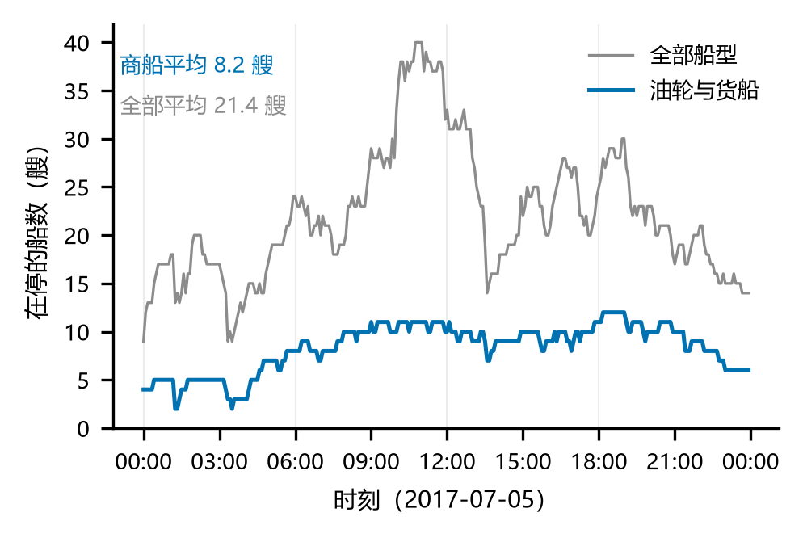

# M6 路演：5 页、5 分钟

规则（手册第 2.7 节）：到时即停，最多 5 页图表，补充结果放附页，被问到再翻；
第一页是研究的问题，最后一页是最不确定的结论。

> 对应的 PPTX 由 `python tools/build_slides.py` 生成（`build/m6_slides.pptx`，6 页 = 5 页正文 + 1 页附页），
> 每页的演讲提示写在备注栏；〔 〕处填你自己的话。

## 第 1 页　问题（约 30 秒）

- 一句话：〔研究问题〕
- 属于哪一层：〔描述／诊断／预测／处方〕
- 答案会改变谁的决定：〔一句话〕

## 第 2 页　数据与方法（约 60 秒）

- 数据：DMA AIS〔官〕，2017-07-05，84,702 行，100 艘船
- 停留：0.5 节 / 30 分钟 / 10 分钟缺口；只保留油轮与货船（46 次）
- 指标：商船在港船时（船·小时/天）与平均在停商船数

## 第 3 页　核心结论（约 90 秒，放主图）

- 一句话结论：〔〕
- 三个支撑数字：〔197.2 船·小时/天；平均在停 8.2 艘；时长中位数 120 分钟〕

## 第 4 页　敏感性（约 60 秒）

- 表：`figures/sensitivity.csv` 的九组
- 一句话：哪些量稳定（商船在港船时 185–203，±10%），哪些不稳定（次数 386→133，是 tau 的机械截断）

## 第 5 页　最不确定的结论（约 60 秒）

- 证据链最薄的一环：〔例如：没有锚地与码头边界，"在港时长"不等于"等泊时长"〕
- 什么样的新数据会推翻它：〔例如：带泊位与锚地边界的 AIS，或港口公布的靠离泊记录〕

## 附页（不问不翻）

- 全部船型 vs 商船的对比（fig3）
- 分布图（fig1）
- 清洗日志与 3 次停留的误差对照

## 排练

〔严格计时 5 分钟；讲稿每页不超过 6 句；把"我们觉得"改成"数据显示"，把"可能"改成具体的条件。〕
